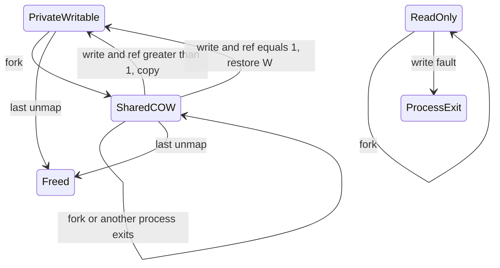

# Copy on Write 设计与验证

## 目标与不变量

fork 后父子进程拥有不同的页表和相同的初始用户数据。可写用户页先共享，首次写入时建立私有页。只读代码页一直保持只读。`CLONE_VM` 共享整个 mm，引用计数增加，其语义与 fork 的独立 mm 对应不同创建路径。

`PTE_COW` 使用 RISC-V 的 RSW 软件位 8。COW 页必须同时具有 V、U 和 COW，W 必须清零，其 VMA 必须允许写。Page.ref 统计物理页的映射数量。页表非叶项只设置 V，满足 Sv39 对 U/A/D 的保留要求。

## 状态转换

| 当前状态 | 事件 | 操作与后继状态 |
|---|---|---|
| 私有可写 W=1、COW=0、ref=1 | fork | 子页表映射同一物理页，父子清 W、设 COW，ref=2 |
| 共享 COW、ref>1 | 任一进程写 | 分配并复制 4 KiB，替换写者 PTE，写者 W=1、COW=0，新页 ref=1，旧页 ref 减一 |
| COW、ref=1 | 写 | 原页恢复 W 并清 COW，无须复制 |
| COW | 再次 fork | 新映射继续共享，ref 增一 |
| 真正只读、COW=0 | fork | 共享只读页，ref 增一 |
| 真正只读 | 写 | 拒绝访问，用户进程以 -E_KILLED 退出 |
| 任意已映射用户页 | exit | 删除映射，ref 减一，降至零时释放 |
| 合法 VMA 内未映射页 | 访问 | 按权限分配清零页，栈底保护页拒绝访问 |
| 共享 COW | 分配失败 | 返回 -E_NO_MEM，原 PTE、数据和引用计数保持一致 |

`copy_range` 先准备子页表项，再建立共享映射并修改父 PTE，随后执行 sfence.vma。新页表分配失败时由 copy_mm 清理已经建立的子映射和页表，父进程残留的独占 COW 页可在下一次写入时恢复权限。`cow_resolve` 在单 hart 关中断区间中完成重新检查、复制、引用更新和 TLB 失效。当前代码的并发保证适用于课程默认的单 hart，扩展多 hart 时需加入页表锁、引用计数原子操作与远端 TLB shootdown。

## 内核写回与 Dirty COW 类问题

Dirty COW 的公开说明涉及私有只读映射 COW 处理中的竞争条件。本实验用确定性的操作顺序演示相近的不变量破坏。临时 mm A 和 B 共享一页，测试保留旧的内核直映地址，随后绕过用户页表写该地址，观察另一方数据改变。这模拟了检查或取页之后映射状态变化，后续仍使用旧物理页写入的错误。[Dirty COW 项目说明](https://dirtycow.ninja/)

修复后的 copy_to_user 先检查整个目标 VMA 范围，在关中断区间内逐页处理 COW，再重新查询当前 PTE 和物理页，检查 U/W 后写入。真正只读的 VMA 即使有物理直映地址也拒绝写入。`do_wait` 通过该函数回写退出码，避免内核直接 memcpy 破坏共享页。

演示数据仅使用测试创建的临时物理页。它覆盖过期物理页指针与 COW 写入检查问题。课程系统尚未实现 Linux 的文件页缓存、get_user_pages、madvise 和 /proc/self/mem，历史漏洞的完整线程竞争需要这些机制支持。

## 测试覆盖

内核测试位于 `kern/mm/cow_test.c`，编译开关为 COW_SELFTEST。测试检查共享 PPN、PTE 权限和 ref，暂时隐藏 PMM 空闲链表注入 OOM，验证失败后的映射完整性。随后复现旧直映指针写入，验证 copyout 修复、单引用恢复权限、真正只读保护、跨页 copyout、按需清零、地址溢出拒绝以及多 VMA 的重复完整回收。

用户测试位于 `user/cowtest.c`。父子分别修改不同页并检查互不影响，保留未修改页的数据，运行三级 fork，验证只读代码写入使子进程退出。另创建 observer 和 worker，让父进程通过 waitpid 将 worker 退出码写入与 observer 共享的数据页，observer 多次调度后仍必须读到原值。

全部补充测试由 `tools/run_checks.py` 实际启动 QEMU，要求检测到测试通过标记和 `init check memory pass.`，同时拒绝用户或内核 panic。两种 QEMU 的串口日志分别保存为 `cowtest-qemu6.log` 和 `cowtest-qemu7.log`。forktree 和 waitkill 额外覆盖孤儿收养、被 kill 的等待者恢复及进程树回收。
