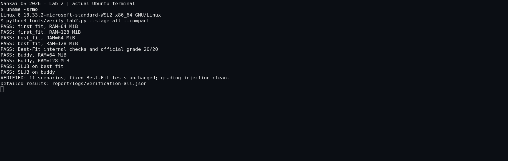
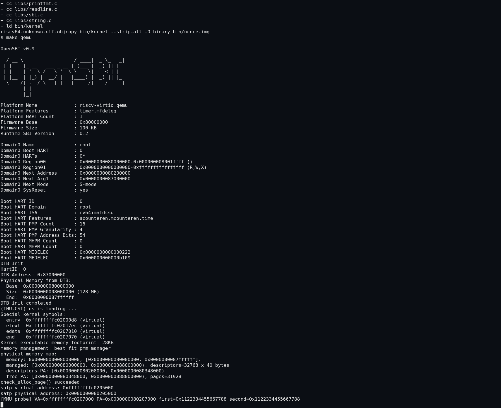
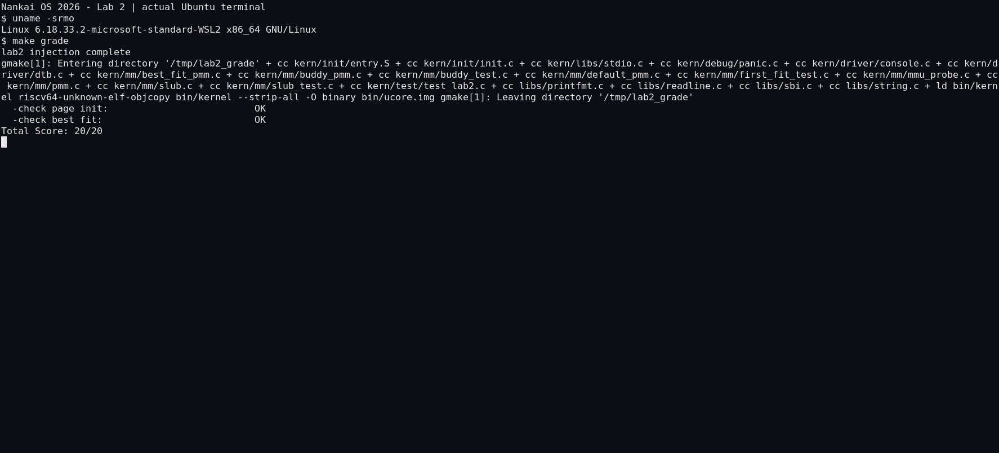
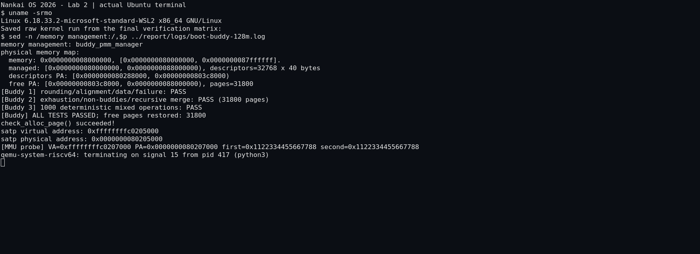
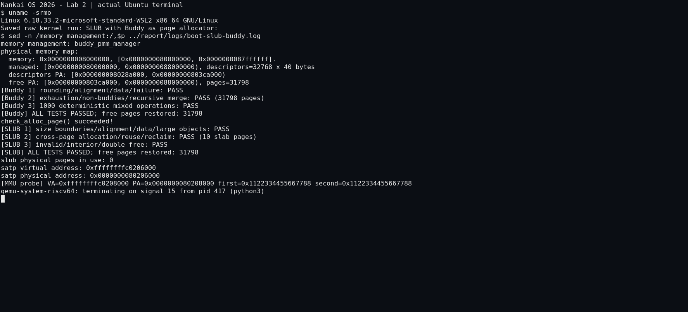
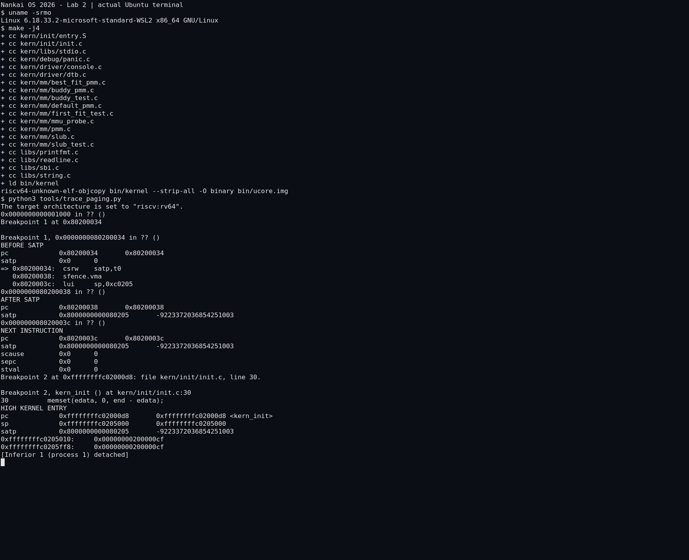
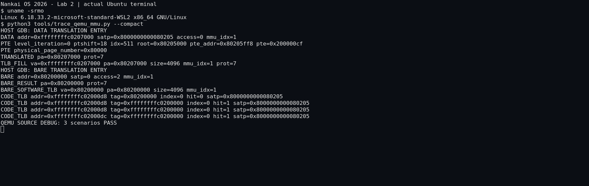

# 操作系统实验报告

## 实验基本信息

| 项目 | 内容 |
|---|---|
| 实验名称 | Lab 2：物理内存和页表 |
| 小组成员 | 2414139-刘宸旭、2411070-王子卓、2413807-缪臻 |
| 完成日期 | 2026-10-18 |
| 仓库 | [nanyan831/os2026，lab2分支](https://github.com/nanyan831/os2026/tree/lab2) |
| 工程与报告 | `code/`、`report/`，沿用小组实验分支目录约定 |

### 小组分工

| 成员 | 模块与验证责任 | 报告与材料责任 |
|---|---|---|
| 2414139-刘宸旭 | 小组组长；负责Buddy System与简化SLUB的实现复核、独立测试及整体集成验收 | 整理Buddy、SLUB和测试验证章节，统稿实验目的与总结，检查提交材料完整性 |
| 2411070-王子卓 | 负责DTB内存范围分析、物理内存初始化和First-Fit逻辑复核，整理尾插合并问题及回归验证 | 整理整体逻辑、物理内存初始化、内存获取思考题和First-Fit章节，核对相关提示词 |
| 2413807-缪臻 | 负责Best-Fit实现与验证、启动分页过渡分析，以及QEMU页表和TLB源码调试 | 整理Best-Fit、构建分页和QEMU调试章节，汇总阶段提示词、运行日志与截图 |

上述分工按Lab2模块安排最终责任，各成员共同复核接口、测试结论与报告内容。实际AI辅助实现与修订过程见[迭代记录](iterations.md)，不将责任分配表作为各成员历史操作的证明。

## 一、实验目的

1. 理解Sv39页表、物理地址、虚拟地址、页号和页描述符之间的关系。
2. 从设备树取得RAM范围，正确保留固件、内核和管理元数据占用，建立可分配物理页区间。
3. 理解First-Fit，实现并接入Best-Fit与Buddy，比较查找、碎片和合并行为。
4. 完成简化SLUB对象分配Challenge，观察页级分配与任意大小对象分配的联系。
5. 在QEMU源码中实际观察页表翻译和软件TLB，并用规格、提示词和测试组织AI辅助开发。

## 二、实验环境

| 项目 | 实测环境 |
|---|---|
| 宿主与Linux环境 | Windows + WSL2 Ubuntu 22.04，Linux 6.18.33.2-microsoft-standard-WSL2 |
| RISC-V编译器 | `riscv64-unknown-elf-gcc` 10.2.0，RV64，`-mcmodel=medany -O2 -g` |
| 基础矩阵A | `/usr/bin/qemu-system-riscv64` 6.2.0，OpenSBI v0.9，11项场景 |
| 基础矩阵B | `/opt/qemu-7.0.0/bin/qemu-system-riscv64` 7.0.0，OpenSBI v1.0，相同11项场景 |
| 源码调试 | 独立构建QEMU 4.1.1，`--enable-debug --disable-werror`，随源码OpenSBI v0.4 |
| 调试器 | 内核使用`gdb-multiarch`；QEMU宿主使用x86-64 `gdb`，版本12.1 |
| 自动化 | Python 3.10.12，GNU make、binutils、bc；截图使用Xvfb、xterm、ImageMagick |

直接从Windows执行WSL Python时优先找到`/usr/bin`的QEMU 6.2；登录Shell优先找到`/opt`的7.0。因此补充了明确指定可执行文件的第二套完整矩阵，避免仅凭一次`--version`推断全部测试运行时。两套结果分别保存，未覆盖原日志。

### 使用的AI工具

| 成员 | AI编程工具 | 底层模型 | 备注 |
|---|---|---|---|
| 刘宸旭 | ChatGPT桌面端 | 待确认实际型号 | Buddy、SLUB、集成验收与报告统稿辅助 |
| 王子卓 | ChatGPT桌面端 | 待确认实际型号 | 内存初始化、First-Fit及相关报告分析辅助 |
| 缪臻 | ChatGPT桌面端 | 待确认实际型号 | Best-Fit、分页与QEMU调试、提示词及证据整理辅助 |

工具名称按小组提供的信息统一填写；具体底层模型尚未提供，保留待确认。阶段9提示词保留形成时的上下文，分工和工具信息已按后续要求补充为本节内容。

## 三、实验整体逻辑分析

### 3.1 本章节的逻辑主线

本实验先解决“哪些RAM能交给内核使用”，再解决“如何组织和分配这些页面”。页表负责解释地址；物理分配器负责页面的所有权和空闲状态。两者相关，但不能用地址已经能够访问来推断该页可以自由分配。

```text
OpenSBI传入hartid/DTB
  → entry.S保存参数、设置启动页表与satp、建立栈并进入高地址C入口
  → kern_init清零BSS、解析DTB
  → pmm_init选择并初始化管理器
  → page_init布置Page数组并保留已用区
  → init_memmap注册完整空闲页
  → alloc_pages/free_pages与管理器check
  → 可选SLUB对象分配检查
  → mmu_probe真实访存与QEMU源码观察
```

### 3.2 功能的逐步实现

`page_init()`和整个Best-Fit模块原来都缺失。Makefile会编译`kern/mm`全部C文件，所以先补齐两个缺项才进行首次完整构建。随后修复实际复现的分页过渡问题，先建立First-Fit基线，再验证默认Best-Fit、Buddy和SLUB，最后调试QEMU源码。报告和提示词从实现阶段同步维护。

## 四、实验内容与实现

以下各模块按最终分工标明责任成员，代码实现、测试结论和阶段提示词均以本工程保存的实际材料为依据。

### 功能模块一：物理内存初始化

**责任成员：** 王子卓。

**核心函数：** `static void page_init(void)`，位于[源码](../code/kern/mm/pmm.c)。

`va_pa_offset`必须先赋值，之后`PADDR(end)`等转换才有意义。`npage`表示物理页号上界，`nbase=0x80000000/4096`，描述符数量是`npage-nbase`，不能误把高物理基址之前的所有页号也分配一份描述符。

实现读取现有DTB接口，检查基址、零长度、加法溢出以及可管理上界。根据框架将管理末端限制在`0x88000000`并向下对齐；将`pages`放在`ROUNDUP(end,4096)`的虚拟地址。先验证描述符数组自身能够放入RAM，再写入全部描述符。所有页先reserved、ref清零，最后仅把元数据末端之后的完整页面交给管理器。

无效DTB、RAM不足以容纳内核/元数据、没有完整可分配页时明确panic；最后一种情形不会调用`init_memmap()`。普通QEMU实测覆盖64、128MiB及256MiB截断场景；非法DTB和元数据不足保护分支在本次进行了代码审查，未声明已经做了硬件故障注入。

默认Best-Fit、128MiB的实际布局为：

| 项目 | 实测值 |
|---|---|
| RAM | `[0x80000000,0x88000000)` |
| `nbase` / `npage` | 524288 / 557056 |
| 描述符 | 32768个，每个40字节，共`0x140000`字节 |
| 描述符物理区间 | `0x0000000080208000` 至 `0x0000000080348000`，右端不含 |
| 初始空闲物理区间 | `0x0000000080348000` 至 `0x0000000088000000`，右端不含 |
| 初始空闲页数 | 31928 |

固件、内核、Page数组和对齐空隙均不进入空闲区。Buddy测试的静态指针数组会增大BSS，因此其空闲页数与Best-Fit不同，测试使用运行时基线，不硬编码同一页数。

**最终提示词：**

```text
[PROMPT]
任务：在 code/kern/mm/pmm.c 的 lab2 function1 标记位置实现 page_init。
操作要求：直接修改工程文件，保留 pmm_init、分配器接口和课程测试；将标记中的 YOUR CODE 替换为 2413807。
输出要求：交付可编译的实际实现、内存布局输出及验证结果。先验证单文件，再与 Best-Fit 完整模块一起构建。

[RELY]
struct Page { int ref; uint64_t flags; unsigned int property; list_entry_t page_link; }。
PGSIZE=4096，DRAM_BASE=0x80000000，PHYSICAL_MEMORY_END=0x88000000，PHYSICAL_MEMORY_OFFSET=0xffffffff40000000。
pages 是 Page 数组虚拟地址；nbase=DRAM_BASE/PGSIZE；npage 是物理页号上界；数组长度为 npage-nbase。
可调用 get_memory_base、get_memory_size、panic、cprintf、init_memmap、pa2page；可用 PADDR、PPN、ROUNDUP、ROUNDDOWN、Page 状态宏和 end 链接符号。
init_memmap 通过当前 pmm_manager 注册空闲区域；其输入页描述符应事先标为 reserved。

[GUARANTEE]
static void page_init(void);
可新增 static 辅助函数；保持现有公开接口与固定测试不变。

[SPECIFICATION]
page_init
Pre-Condition：启动分页与 DTB 解析已完成，PMM 已 init，但没有注册空闲页；本实验只有从 DRAM_BASE 开始的一个 RAM 区域。
Post-Condition：va_pa_offset、npage、pages 正确；描述符覆盖受支持 RAM；OpenSBI、内核、描述符和对齐空隙均保留；只有之后完整页面进入分配器。
Case 1：合法范围。根据 DTB 和框架上界确定管理末端；打印探测范围及实际管理范围；描述符数组从 ROUNDUP(end,PGSIZE) 开始，确认其物理末端未越界之后才写入。先将所有描述符初始化为 reserved、ref=0，再注册对齐后的非空空闲区。
Case 2：无效基址、零大小、加法溢出、受支持区间不足以容纳内核/描述符。panic 并终止，不访问越界描述符。
Case 3：没有完整可分配页面。不得调用 init_memmap；给出明确 panic。
Requirements：必须先设置偏移再调用 PADDR；不得混用 VA、PA、PPN 和 Page 指针；不得把 npage 当作数组元素数量；不硬编码 free 页数。
```

**迭代记录：** 此模块第一次实现通过编译。首次整体启动未进入C代码，GDB定位到启动页表缺少低地址映射；这是集成启动问题，未伪写成页描述符算法的多轮失败。详见[真实修订记录](iterations.md)。

### Challenge思考题：无法预知硬件内存范围时如何获取

应让固件或启动加载器通过约定协议交付内存图，而不是任意地址试读写。RISC-V本实验从a1取得DTB，读取`/memory`的`reg`地址/长度；真实通用实现还应解析多个区域及保留区。设备树规范允许多节点或一个节点的多个地址/大小对。[Devicetree规范](https://devicetree-specification.readthedocs.io/en/stable/devicenodes.html#memory-node)

UEFI平台可由加载器调用`GetMemoryMap()`取得带类型的内存描述符，内核区分可用RAM、固件和保留区域后建立管理结构。[UEFI GetMemoryMap](https://uefi.org/specs/UEFI/2.10_A/07_Services_Boot_Services.html#efi-boot-services-getmemorymap)

固定嵌入式平台也可由板级信息提供可信布局。获得图后仍要排除MMIO、固件、内核和元数据；“总容量”本身不足以确定哪些地址可分配。本实验的简化解析器只使用一个起点固定的RAM区间，未扩展成通用设备树实现。

### 功能模块二任务一：理解First-Fit

**责任成员：** 王子卓。

源码见[default_pmm.c](../code/kern/mm/default_pmm.c)。

| 函数 | 功能与状态变化 |
|---|---|
| `default_init` | 初始化空闲链表，空闲页计数归零 |
| `default_init_memmap` | 将保留描述符转换为空闲区，块头记录页数，按地址加入链表 |
| `default_alloc_pages` | 从链表起点找到第一个足够大的块；精确匹配则移除，较大块保留余段；计数减n |
| `default_free_pages` | 清理引用与标志，按地址插入，分别检查前后块是否物理连续，再合并；计数加n |

**改进空间：** 线性扫描的最坏复杂度为O(k)，碎片多时查找成本增加；可考虑大小分组、合适的树结构或不同的分配策略，但需同时维护地址相邻关系。Next-Fit改变起点不保证减少碎片，Best-Fit也不保证全局最优。这里先保证链表正确性和资源守恒。

**发现并修复的具体问题：** 原模板尾插后没有`break`。循环下一轮又经过刚插入的节点，可能令该节点`prev`指向自身，导致前向相邻块未合并。原固定测试仍能通过，因此另用公开接口申请全部可用页、顺序释放前两个单页、再申请2页。原实现实际在`pair == all`断言处panic，见[失败日志](logs/first-fit-regression-original.log)。在两个尾插成功位置加`break`后，固定测试和新回归均通过，完整可用区能够再次整块分配。

**追加回归提示词：**

```text
[PROMPT]
任务：复核课程提供的 First-Fit 链表尾插，增加独立回归验证其连续页回收；发现问题后做最小修复。
操作要求：先用原实现实际复现，不修改 basic_check/default_check；修复后保留原固定测试与新回归。
输出要求：失败原始日志、修复差异、两个 RAM 配置下的通过证据。

[RELY]
default_init_memmap/default_free_pages 按地址查找插入点，在尾部 list_add 后没有 break。
list_add 的 __list_add 会同时修改 prev/next；循环继续经过新插入的节点可能把其 prev 置为自身。
公开接口 alloc_pages/free_pages/nr_free_pages；启动后初始空闲区为一个连续块。

[GUARANTEE]
void first_fit_regression_check(void);
固定测试代码原样；管理实现仅修复已证实的插入后循环问题。

[SPECIFICATION]
Pre-Condition：First-Fit 固定测试已经完成，所有页面已恢复。
Case 1：申请全部可用连续区间，清空自由链表；依次释放前两个相邻单页，申请2页必须成功返回同一基址。该场景可击穿尾插后未与前块合并的错误。
Case 2：重新释放该2页块及剩余区域，必须合并成原来的完整连续区间，能再次整块申请；最终全部恢复。
Case 3：如果原实现失败，检查尾插继续循环造成的反向链接，再在成功插入后结束循环；初始化插入的同类问题同步修复。
Post-Condition：原固定测试及新增回归均通过，空闲页计数完全恢复。
Requirements：不绕过断言，不硬编码空闲地址和页数，不扩展为无关分配策略改写。
```

### 功能模块二任务二：Best-Fit

**责任成员：** 缪臻。

源码见[best_fit_pmm.c](../code/kern/mm/best_fit_pmm.c)，包括初始化、空闲区注册、最小满足块查找、拆分、释放合并、计数和`best_fit_pmm_manager`。

保持空闲链表按地址递增，申请时扫描满足请求的最小块，长度相同时选择先遇到的低地址块。精确匹配可以提前停止；分配后正确迁移余块块头。释放支持已分配区间的部分回收，再通过相邻地址关系与前后块合并。

固定`basic_check()`和`best_fit_check()`的文本保留原样，SHA-256为`b6c6f8cd0608f21e2710f19ce23847f74c36b68d67dea90e8eef9faacdc9022a`。测试直接保存、清空并恢复`free_list`和`nr_free`，因此实现采用对应状态和访问宏，没有另建不可同步的隐藏索引。两页块与一页块并存时，一页请求选中一页块的断言实际通过。

`init_pmm_manager()`默认选择Best-Fit，`PMM=first_fit`、`PMM=buddy`可选择其他实现。仅定义管理器而不实际选择它不能满足课程测试。

**改进空间：** 当前查找O(k)，地址有序链表便于合并但不便按大小检索。可以同时维护地址和大小索引，将查找降到O(log k)，代价是更新复杂、额外元数据和更强的状态一致性要求。Best-Fit可能生成很多很小的余块，不能仅凭名称认为它必然比First-Fit更快或碎片更少。

**最终提示词：**

```text
[PROMPT]
任务：在 code/kern/mm/best_fit_pmm.c 的 lab2 function2-2 位置实现完整 Best-Fit，接入 pmm.c。
操作要求：真实修改文件；保留 basic_check 和 best_fit_check 的全部原始文本；标记学号为 2413807。
输出要求：完整管理器、默认 Best-Fit 配置、可复现的普通运行/测试/评分证据。

[RELY]
阅读 default_pmm.c、pmm.h、memlayout.h、list.h 的真实定义。
struct pmm_manager 包含 name/init/init_memmap/alloc_pages/free_pages/nr_free_pages/check。
free_area_t 包含 free_list 和 nr_free；Page.property 是空闲块页数，PG_property 只标记块头。
固定测试会直接保存、清空、恢复本文件的 free_list 和 nr_free；还会部分释放五页分配，并要求一页请求选择单页块而非两页块。
alloc_pages/free_pages 通过当前管理器派发；测试回调运行前 PMM 已初始化且有空闲页。

[GUARANTEE]
static void best_fit_init(void);
static void best_fit_init_memmap(struct Page *base, size_t n);
static struct Page *best_fit_alloc_pages(size_t n);
static void best_fit_free_pages(struct Page *base, size_t n);
static size_t best_fit_nr_free_pages(void);
const struct pmm_manager best_fit_pmm_manager;
check 指向原有 best_fit_check；必要时添加前置声明。

[SPECIFICATION]
init/init_memmap
Pre-Condition：init 先于 memmap；待注册描述符均 reserved。
Post-Condition：维护按地址递增的空闲块链表与准确空闲页计数，每块只有头页 PG_property=1；初始化时清零 ref。
alloc_pages
Pre-Condition：n>0。
Post-Condition：返回最小满足块的前 n 页，若同大小取较低地址；返回区间不再空闲，余块位置、长度和计数正确。
Case 1：精确匹配，移除块；Case 2：较大块，保留 n 页之后的余块；Case 3：没有连续满足块或空链表，返回 NULL 且状态不变。
free_pages
Pre-Condition：合法的已分配连续区间，可为早先分配的子区间；不允许释放保留页或重复释放。
Post-Condition：ref 清零，空闲计数增加 n；按地址插入并与物理连续前后块合并，清除不再作为块头的标记。
nr_free_pages 返回准确计数，不依赖不可随固定测试一起恢复的缓存。
Requirements：固定测试不可修改；分配失败不破坏状态；完成后实际启用 best_fit_pmm_manager。
```

**结果：** 第一次完整实现通过固定算法检查，`make test`输出6/6；官方临时副本评分为20/20。未修改固定测试来适配生成代码。

### 功能模块二任务三：Buddy System

**责任成员：** 刘宸旭。

源码：[实现](../code/kern/mm/buddy_pmm.c)、[接口](../code/kern/mm/buddy_pmm.h)、[独立测试](../code/kern/mm/buddy_test.c)。

每阶一条空闲链表，块大小为`2^order`页。初始空闲区按绝对物理页号的对齐关系切分，不假定数组索引或空闲起点天然按大块对齐。申请向上取整，逐级拆分；用额外flags区分分配块及其头页，`property`记录真实页数，引用计数仍保留正常语义。

释放从实际块头开始，参数向上取整后必须与真实块大小一致；以物理页号异或块大小得到伙伴，只有同阶且空闲时才能合并。回收计数使用真实占用页数。相邻但不是伙伴的页不能直接合成更大块。当前是单hart实现，未增加并发锁或多区域热插拔机制。

**实现提示词：**

```text
[PROMPT]
任务：从零新增 code/kern/mm/buddy_pmm.c、buddy_pmm.h，接入现有 PMM；Makefile 支持 PMM=buddy，默认仍为 best_fit。
操作要求：真实修改工程，保持 First-Fit/Best-Fit 固定测试与官方注入流程；本提示词只规定实现接口，下一提示词独立设计测试。
输出要求：完整按阶空闲表、正确分配/释放与可重复选择配置；描述元数据和空间损耗。

[RELY]
struct Page 的 ref、flags、property、page_link；pmm.h 的六项回调、page2ppn、page2pa、pa2page；list.h 链表操作。
物理空闲区起点经过内核和描述符布局计算，通常不是最大阶对齐；初始化的描述符处于 reserved。
alloc_pages/free_pages 接口允许处理至少 n 页。内核为单 hart、无并发分配；不需要引入锁。

[GUARANTEE]
const struct pmm_manager buddy_pmm_manager;
六项管理器回调和 void buddy_check(void) 测试回调接入点。
size_t buddy_block_pages(struct Page *base); void buddy_validate(void);
新增头文件公开测试所需的只读状态检查接口，内部辅助函数 static。

[SPECIFICATION]
init/init_memmap
Pre-Condition：先 init，后将合法 reserved 区间交给 init_memmap。
Post-Condition：区间完整分解为以物理页号对齐的2的幂次块，计数不丢页，只有空闲块头带 PG_property，内部元数据状态清晰。
alloc_pages
Case 1：n>0，向上取整到2的幂，找到不小于目标阶的最小非空阶，递归拆分；返回对齐且不重叠块，实际占用页数可查询，nr_free 减少实际页数。
Case 2：n=0、超过最大阶或连续块不足，返回 NULL，状态不变。
free_pages
Pre-Condition：base 是先前分配的块头，n 的取整大小与实际块一致；禁止 interior free、double free、reserved free。
Post-Condition：按真实块大小回收，以物理页号异或找到同阶伙伴，只有伙伴确实空闲且同阶才合并，递归向上；nr_free 增加实际页数。
buddy_validate 检查每阶块大小、对齐、边界、链表和空闲总计，不修改分配状态。
Requirements：不修改 struct Page 布局；可用附加 flags 区分 allocated 和 allocated-head；ref 保持正常语义；不得假设空闲区天然最大阶对齐。
```

**独立测试提示词：**

```text
[PROMPT]
任务：依据 Buddy 的接口契约，在 code/kern/mm/buddy_test.c 独立设计 buddy_check。真实运行，不能仅复述实现逻辑。
操作要求：不访问实现的私有空闲链表；通过 alloc_pages/free_pages/nr_free_pages、地址和公开只读检查验证可观察行为；不创建 kern/test 构建目录。
输出要求：断言、具名通过项、资源恢复证据，以及各测试为何能发现错误的说明。

[RELY]
上一阶段的外部契约：向上取整、物理页号对齐、实际占用计数、同阶伙伴合并、分配失败不改变状态。
buddy_block_pages 只读查询实际块大小，buddy_validate 检查内部不变量。
测试开始时可用页数由 nr_free_pages 动态取得，不能硬编码本机内核大小。

[GUARANTEE]
void buddy_check(void);
测试独立源文件，可使用静态测试指针数组；退出时所有测试占用必须释放。

[SPECIFICATION]
Pre-Condition：当前管理器为 Buddy，初始空闲区已建立。
Post-Condition：无 assert/panic；结束空闲页数等于开始值；输出每组行为结果。
Case 1：请求1、2、3、5、17、64页，以独立的幂次取整期望验证实际页数、对齐、互不重叠和计数变化；在块中写入并检查数据，防止地址重叠。
Case 2：零大小和超过内存的请求返回 NULL，计数不变。
Case 3：耗尽全部可用单页，验证失败；在一个对齐16页区域内只释放两个非伙伴页，2页申请必须失败；补齐真伙伴后2页成功，再逐级补齐并申请4页/16页，证明递归合并。释放其余单页并核对完全恢复。
Case 4：固定种子的混合申请/释放，检查地址区间和数据；全部释放后计数恢复。
Requirements：构造能够击穿“只相邻就合并”和“从不合并”两种错误的案例；不能把 Best-Fit 固定测试改成 Buddy 测试；不依据管理器自己声称成功就判通过。
```

| 测试 | 为什么能检验实现 |
|---|---|
| 1/2/3/5/17/64页请求、对齐、区间不重叠与首尾数据 | 检查取整、块边界、真实计数及错误重叠 |
| 零大小、过大请求，失败前后计数不变 | 检查失败不会消耗或破坏资源 |
| 耗尽全部可用单页 | 验证初始化分解没有丢页，并制造没有其他空闲块干扰的环境 |
| 只释放两个非伙伴单页后申请2页必须失败 | 能击穿“只要相邻/数量够就合并”的错误 |
| 补齐真伙伴后申请2页、4页、16页成功 | 能击穿从不合并或只合并一层的错误 |
| 1000次固定种子混合申请/释放 | 验证长期状态转换和数据独立，最终恢复初始空闲页数 |

这些测试在64MiB、128MiB及两种日常QEMU版本下均通过。初始区域的非整阶处理由全量单页耗尽后`count==baseline`和资源恢复共同约束，没有仅由分配器自身打印“成功”来判断。

### Challenge：简化SLUB对象分配

**责任成员：** 刘宸旭。

源码：[slub.c](../code/kern/mm/slub.c)、[接口](../code/kern/mm/slub.h)、[独立测试](../code/kern/mm/slub_test.c)。

上层把1～2048字节请求放入16、32、64、128、256、512、1024、2048字节类别。一个slab页含页头、分配位图和等大对象；空闲对象自身保存下一对象地址，部分使用的页放入类别链表。对象至少16字节对齐；满页移出可分配链表，释放后重新加入，最后一个对象释放时整页归还下层。

大于2048字节的请求由页分配器提供连续页，页头保存申请和真实占用信息；Buddy的取整损耗体现在占用计数中。零大小与溢出请求返回NULL，内部偏移地址和重复释放返回-1。这里体现两层分配思想，未声称实现Linux完整SLUB、per-CPU缓存、NUMA或并发回收。

**实现提示词：**

```text
[PROMPT]
任务：从零新增 code/kern/mm/slub.c、slub.h，基于当前页分配器实现两层对象分配，作为 SLUB 思想的简化教学实现。
操作要求：真实接入内核的可选 SLUB_TEST 配置；不得声称实现 Linux 完整 SLUB；保持默认评分路径不变。
输出要求：对象大小类别、页内空闲对象组织、对象验证和空页回收；下一阶段单独设计测试。

[RELY]
底层 alloc_pages/free_pages/nr_free_pages；上层只能使用内核已提供的类型、链表、字符串操作和 VA/PA 转换。
Best-Fit 精确分配页数，Buddy 向上取整；可用 buddy_block_pages 确认 Buddy 实际占用。
当前内核单 hart，无并发；对象要求至少16字节对齐。

[GUARANTEE]
void *slub_alloc(size_t size); int slub_free(void *ptr);
size_t slub_pages_in_use(void); void slub_check(void);
辅助函数和缓存状态限制在模块内；不修改已有 PMM 公开接口。

[SPECIFICATION]
alloc
Pre-Condition：物理页管理器已初始化。
Case 1：1..2048字节，选择16/32/64/128/256/512/1024/2048类别，先复用非满 slab 页中的空闲对象，无可用对象才申请新页。对象区和头部不重叠。
Case 2：更大对象，检查长度加法溢出后申请连续页，保存真实分配信息。
Case 3：零大小、溢出或资源不足，返回 NULL，不泄漏。
free
Case 1：合法对象，回收到其类别；满页重新成为可分配页；最后一个对象释放时归还整页。
Case 2：合法大对象，归还对应完整分配块。
Case 3：NULL 为无操作；非对象起点或已释放对象返回 -1，不破坏状态。
Post-Condition：活跃对象不重叠，返回值对齐；所有对象释放后本模块页占用回到0，底层资源恢复。
Requirements：用 bitmap 验证对象是否正在分配；每页只有一个页头；不保留空缓存页；计数考虑 Buddy 的取整占用。
```

**独立测试提示词：**

```text
[PROMPT]
任务：在 code/kern/mm/slub_test.c 独立测试上一阶段对象分配契约；分别在 Best-Fit 和 Buddy 下真实运行。
操作要求：只依据接口、地址、数据和底层空闲页数断言，不复制分配器查找逻辑。
输出要求：具名测试结果、边界、复用、数据独立性和回收证据。

[RELY]
slub_alloc/slub_free/slub_pages_in_use；nr_free_pages；对象16字节对齐；所有释放后不保留空页。

[GUARANTEE]
void slub_check(void);
保留测试前后资源计数，失败通过 assert 明确暴露。

[SPECIFICATION]
Pre-Condition：页分配器检查已经通过。
Case 1：测试0、1、15、16、17、31、32、33、2048、2049、4096、6000、16384和溢出长度。
Case 2：给同时存活对象写入不同模式，验证每个请求范围中的内容不被其他对象覆盖及16字节对齐。
Case 3：同一类别跨多个 slab 页，先释放部分再分配，检查复用且页占用未增加；奇偶次序释放后全部回收。
Case 4：释放内部偏移地址和已释放对象应失败，合法对象及计数保持正确；NULL 释放成功且无副作用。
Post-Condition：slub_pages_in_use()==0，nr_free_pages 等于初始值；分别在两个底层分配器配置留证。
Requirements：测试验证尺寸边界与资源守恒，不能仅检查返回非NULL。
```

测试覆盖大小类别边界、2048/2049转换、跨页大对象、数据内容和不重叠、600个64字节对象跨多个slab页、部分释放后的复用、非法/重复释放与整页归还。Best-Fit、Buddy两种下层均通过，结束时`slub_pages_in_use()==0`且空闲页数恢复。

### 集成：构建与分页过渡修复

**责任成员：** 缪臻负责构建与分页分析，刘宸旭负责整体集成验收。

原模板在写satp之后仍执行低地址指令，但根表只有高地址索引511。真实GDB日志显示PC从`0x80200034`的satp写入到`0x80200038`后，无法访问后续取指位置，见[修复前日志](logs/03-paging-before-fix.log)。增加索引2的1GiB恒等映射，保留索引511高地址映射后，该执行窗口有效，能够进入高地址C入口。

普通、debug、test和评分统一使用`-kernel`传递镜像，确认固件下一阶段地址为`0x80200000`；GDB配方实际使用可用的`gdb-multiarch`回退。评分增加对自身QEMU进程的清理，不改变检查项或分数。`sfence.vm`辅助接口改为当前使用的`sfence.vma`，修正未使用宏的拼写，补充`pa2page`下界检查。

**集成提示词：**

```text
[PROMPT]
任务：让当前 ucore 在实际 WSL 的 RISC-V GCC/QEMU/GDB 组合中完整构建，调试并验证进入高地址内核。
操作要求：真实运行构建和调试，先记录故障再做必要修复；不改写或绕过课程算法测试和评分断言。
输出要求：构建日志、固件交接信息、GDB 中的启动过渡证据，以及普通/测试/评分三种路径的一致配置。

[RELY]
原 Makefile 的 qemu/debug/test 与 tools/grade.sh 均使用 -device loader；本机 QEMU=7.0.0。
本机有 gdb-multiarch，专用 riscv64-unknown-elf-gdb 未发现；gdb 配方原来硬编码专用 GDB。
entry.S 写 satp 后继续在低地址执行，再跳到高地址 kern_init；原页表只在索引511提供高地址1GiB映射。
内核物理入口0x80200000，高地址链接0xffffffffc0200000；OpenSBI 经 a0/a1 传递 hartid/DTB。

[GUARANTEE]
一致的 QEMU 启动参数、可用 GDB 配方和确实可执行的分页启动过程。
新增可复现脚本，所有输出来自真实命令；评分注入只在临时副本进行。

[SPECIFICATION]
Pre-Condition：page_init 与 Best-Fit 已补齐，固定测试原样。
Post-Condition：普通运行实际进入内核并完成检查；GDB 能观察到物理入口、satp 和高地址入口；make grade 运行同一启动路径。
Case 1：固件未正确交接。核对 next address/mode，验证 -kernel 适配并同步全部入口。
Case 2：分页切换后取指失败。读取 pc/satp/scause/sepc/stval，分析当前页表，再通过必要的恒等映射或正确跳转修复；保留原高地址映射。
Case 3：编译/汇编兼容问题。记录原始诊断，仅修改相应编译选项或实际使用的接口。
Requirements：不把 OpenSBI 横幅当作内核成功；永久循环的 QEMU 使用有界退出；不覆盖系统 QEMU，不改变全局调试权限。
```

修复后的客体GDB观察：satp从0变为`0x8000000000080205`；低地址下一条指令可执行，异常寄存器为0；随后到`kern_init=0xffffffffc02000d8`，`sp=0xffffffffc0205000`。根表索引2与511的PTE均为`0x200000cf`。这些是当前默认构建地址，不是所有版本的固定常量。

### 分支任务：QEMU页表与TLB源码调试

**责任成员：** 缪臻。

QEMU4.1.1独立构建在`/home/compiler/oslab2/qemu-4.1.1/build-debug`，未执行`make install`。宿主GDB直接启动自己的QEMU子进程，客体GDB仍用于观察内核启动，两层目标分别留证。

**调试提示词：**

```text
[PROMPT]
任务：依据指导书编译 QEMU 4.1.1 的独立调试版本，实际观察一条内核 load 的 Sv39 翻译、软件 TLB 填充和代码 TLB 命中；对比 Bare 模式。
操作要求：使用真实内核与 QEMU 源码，按当前版本找断点；宿主 GDB 启动自己的 QEMU 子进程，避免修改系统 ptrace 策略；保留内核 GDB 的分页过渡观察。
输出要求：可重复运行脚本、原始 GDB 日志、关键调用路径与分支解释、准确的 VA/PTE/PA/软件TLB数据。

[RELY]
QEMU 4.1.1 源码 target/riscv/cpu_helper.c 的 riscv_cpu_tlb_fill、get_physical_address；accel/tcg/cputlb.c 的 get_page_addr_code、tlb_fill、tlb_set_page_with_attrs。
当前启动根页表索引2为低地址恒等映射，索引511为高地址1GiB叶子；内核映射偏移0xffffffff40000000。
添加一个对齐的 volatile probe word 和连续两次 load，保证可观察的数据地址与结果；probe 前执行 sfence.vma。
裸地址入口0x80200000，符号的实际地址由当前 ELF/nm 读取，不能沿用旧构建常量。

[GUARANTEE]
void mmu_probe(void); volatile uint64_t mmu_probe_word;
可重现的宿主 GDB 源码跟踪工具及内核 tools/trace_paging.py。
调试日志标明调试的是宿主 QEMU 还是 RISC-V 客体，不混淆软件 TLB 和真实硬件 TLB。

[SPECIFICATION]
Pre-Condition：默认 Best-Fit 内核可正常启动，独立 QEMU 含源码与调试符号。
Case 1：在 mmu_probe_word 的真实 data load 上观察 tlb_fill 进入页表遍历，记录 satp、访问类型、PTE地址/值、叶子层级；返回 caller 后核对 pa=va-offset，并观察软件TLB填充。
Case 2：在 get_page_addr_code 的 C 查询处，记录同一代码页从无效 tag 到有效 tag 的变化，显示后续查询命中并跳过重新填充。
Case 3：Bare 模式下记录相同翻译接口返回物理地址等于输入地址，仍可填充 QEMU 软件TLB，说明它同时承担客体到宿主内存的映射缓存。
Post-Condition：脚本有界退出，只清理自己启动的进程；日志来自实际断点，不以推测值代替运行数据。
Requirements：本内核根级大页会提前结束页表遍历，不能伪造三次读表；说明 TCG 内联数据快路径与 C 慢路径的区别；记录调试中真实遇到的问题。
```

#### 1．关键调用路径及分支

真实数据load的栈为：

```text
TCG code_gen_buffer
  → helper_le_ldq_mmu / load_helper
  → tlb_fill
  → riscv_cpu_tlb_fill
  → get_physical_address
  → tlb_set_page / tlb_set_page_with_attrs
```

页表遍历先判断M模式或MMU能力，再看satp模式；Bare直接返回输入地址。Sv39取satp中的根物理页号，检查虚拟地址规范形式，然后按VPN索引读PTE。分支依次区分无效项、指向下一级的非叶子、保留权限组合、U/S权限、大页对齐和访问权限；需要时更新A/D。遇到合法叶子后计算物理页并返回权限。当前PTE已有A/D，未把它们的原子更新分支写成已经单步执行过。

#### 2．实际load的VA到PA

`mmu_probe_word`在独立对齐数据页上，`mmu_probe()`先执行`sfence.vma`，随后两次volatile读取，确保访存确实存在。宿主断点没有通过客体GDB提前读该数据页来代替CPU访存。

| 观察项 | 实际值 |
|---|---|
| VA / access_type / mmu_idx | `0xffffffffc0207000` / 0（load）/ 1（S） |
| satp / 根表PA | `0x8000000000080205` / `0x80205000` |
| 首轮索引与PTE地址 | 511 / `0x80205ff8` |
| PTE / PPN | `0x200000cf` / `0x80000` |
| 遍历轮次 / ptshift | 0 / 18 |
| 翻译PA / prot | `0x80207000` / 7 |
| 软件TLB填充大小 | 4096字节 |

当前根级就是合法叶子，因此是1GiB大页，遍历在第一轮结束，并没有读取三张表。用大页基址`0x80000000`加VA低30位偏移`0x207000`，得到`0x80207000`，与实际返回值一致。探针页内偏移为0；QEMU这里计算页地址，其他页内偏移由后续访存路径补回。

原始日志：[数据页表遍历](logs/qemu-data-walk.log)。

#### 3．软件TLB查询与命中

在`accel/tcg/cputlb.c`的`get_page_addr_code()`查询处，观察到同一高地址代码页：

```text
第一次：addr=0xffffffffc02000d8，tag=0x80200000，hit=0
之后：  addr=0xffffffffc02000d8，tag=0xffffffffc0200000，hit=1
下一条：addr=0xffffffffc02000dc，tag=0xffffffffc0200000，hit=1
```

这是实际C查询分支记录。未命中时检查victim表，仍失败才调用体系结构TLB填充；命中则跳过重新填充。数据访存还可能走TCG生成的内联快路径，不能因为第二次load没有再次进入C慢路径就认为没有查TLB。[原始日志](logs/qemu-code-tlb.log)

#### 4．与Bare及真实硬件TLB的区别

在Bare下，观察`addr=0x80200000`、`satp=0`、返回PA相同，但QEMU仍执行软件TLB填充，大小4096。这说明QEMU软件TLB不仅缓存客体页表结果，还服务于客体地址到宿主内存/访问处理的快速映射。真实CPU的地址翻译TLB与软件实现目标不同，不能将QEMU内部表结构当作所有处理器的硬件结构。[Bare原始日志](logs/qemu-bare.log)

本次QEMU4.1.1把根级1GiB映射的结果按4KiB填入软件TLB。软件TLB、TCG翻译块缓存和客体页表是三个不同层次，不应混称为一张缓存。

#### 5．调试过程与AI协作记录

先定位函数和条件断点再启动QEMU，避免每个地址都暂停。断点使用当前ELF的符号读取实际探针地址，不沿用旧构建常量。区分`finish`后的调用者局部变量`pa`与被调用函数的`physical`指针，才能记录有效结果。源码构建曾放在临时目录，目录失效后改为独立用户目录并保留构建脚本。所有提示词和真实修订见[汇总](prompt.md)与[迭代记录](iterations.md)。

## 五、测试与验证

### 5.1 最终运行矩阵

两套日常QEMU各11个场景通过，另有QEMU4.1.1的3个宿主源码调试场景和客体分页过渡观察。

| 场景 | QEMU6.2 | QEMU7.0 | 原始证据 |
|---|---|---|---|
| First-Fit，64 MiB，含尾插回归 | 通过 | 通过 | [6.2日志](logs/boot-first_fit-64m.log) / [7.0日志](logs/qemu7/boot-first_fit-64m.log) |
| First-Fit，128 MiB，含尾插回归 | 通过 | 通过 | [6.2日志](logs/boot-first_fit-128m.log) / [7.0日志](logs/qemu7/boot-first_fit-128m.log) |
| Best-Fit，64 MiB | 通过 | 通过 | [6.2日志](logs/boot-best_fit-64m.log) / [7.0日志](logs/qemu7/boot-best_fit-64m.log) |
| Best-Fit，128 MiB | 通过 | 通过 | [6.2日志](logs/boot-best_fit-128m.log) / [7.0日志](logs/qemu7/boot-best_fit-128m.log) |
| Best-Fit，256 MiB，管理上界截断到128 MiB | 通过 | 通过 | [6.2日志](logs/boot-best_fit-256m-capped.log) / [7.0日志](logs/qemu7/boot-best_fit-256m-capped.log) |
| Best-Fit `make test`，6/6 | 通过 | 通过 | [6.2日志](logs/best-fit-test.log) / [7.0日志](logs/qemu7/best-fit-test.log) |
| 课程 `make grade`，20/20 | 通过 | 通过 | [6.2日志](logs/official-grade.log) / [7.0日志](logs/qemu7/official-grade.log) |
| Buddy，64 MiB | 通过 | 通过 | [6.2日志](logs/boot-buddy-64m.log) / [7.0日志](logs/qemu7/boot-buddy-64m.log) |
| Buddy，128 MiB | 通过 | 通过 | [6.2日志](logs/boot-buddy-128m.log) / [7.0日志](logs/qemu7/boot-buddy-128m.log) |
| SLUB + Best-Fit | 通过 | 通过 | [6.2日志](logs/boot-slub-best_fit.log) / [7.0日志](logs/qemu7/boot-slub-best_fit.log) |
| SLUB + Buddy | 通过 | 通过 | [6.2日志](logs/boot-slub-buddy.log) / [7.0日志](logs/qemu7/boot-slub-buddy.log) |

官方评分只提供初始化与Best-Fit两项，各10分；Buddy、SLUB和QEMU分支分别使用自己的证据。256MiB场景验证框架管理上界截断，未声称此配置通过要求`npage`等于原始DTB末端的官方初始化测试。

### 5.2 真实终端截图

以下由Xvfb中的实际xterm运行命令后捕获；Buddy/SLUB两张明确展示最终矩阵保存的原始内核运行日志。图片未用生成式工具重造输出。

最终矩阵：



默认构建与QEMU运行：



官方评分：



Buddy原始内核运行记录：



简化SLUB原始内核运行记录：



客体GDB分页过渡：



宿主QEMU源码GDB：



### 5.3 可复现步骤

```bash
git clone --branch lab2 --single-branch https://github.com/nanyan831/os2026.git
cd os2026/code
make clean && make
make qemu
# Ctrl+A，松开后按X退出；切换配置前先clean。
make clean && make test
make grade
python3 tools/verify_lab2.py --stage all --compact --qemu /usr/bin/qemu-system-riscv64
python3 tools/verify_lab2.py --stage all --compact --qemu /opt/qemu/bin/qemu-system-riscv64 --log-label qemu7
```

两条Python命令的QEMU路径是本机实际路径，其他机器使用自己的可执行文件位置。测试矩阵最后会留下Buddy+SLUB镜像；恢复默认用`make clean && make`。普通`make qemu`会持续运行是内核设计，并非超时即失败。

```bash
make clean && make PMM=buddy
make qemu PMM=buddy
make clean && make SLUB_TEST=1
make qemu SLUB_TEST=1
make clean && make PMM=buddy SLUB_TEST=1
make qemu PMM=buddy SLUB_TEST=1
# 恢复默认并观察启动分页：
make clean && make
python3 tools/trace_paging.py
# 编译独立QEMU需要宿主编译器、glib/pixman开发依赖和curl等：
bash tools/build_qemu_debug.sh
python3 tools/trace_qemu_mmu.py --compact
```

`make debug`与`make gdb`分别在两个内核终端运行。宿主源码调试脚本采用条件断点直接启动QEMU，等价地隔离了两层调试目标，没有要求修改全局ptrace权限。

**最终验证与交付提示词：**

```text
[PROMPT]
任务：按实验报告模板完成 Markdown 报告和全量复现材料，保留各阶段四段式提示词、实际修订与原始证据。
操作要求：从最终代码运行构建/测试/评分；截图实际 X 终端，不用生成图片替代运行结果；只提交实验代码与资料，不包含 QEMU 源码/构建目录。
输出要求：报告、提示词索引、迭代日志、真实截图、测试矩阵、README、可复现提交状态。

[RELY]
实验报告模板.md；当前工程代码；report/prompts/01..08；report/logs 实测结果。
固定测试原始 SHA-256 和评分注入清洁约束；当前默认 Best-Fit，Buddy 与 SLUB 独立配置。
小组成员姓名和学号已由仓库 README 确认，但 Lab2 的其他成员分工与工具/模型没有提供。

[GUARANTEE]
report/report.md、report/prompt.md、report/iterations.md、report/images、report/logs。
code/tools 中可复现的验证与调试脚本，仓库 README 的实际运行步骤。

[SPECIFICATION]
Pre-Condition：核心分配器和扩展功能已实现，QEMU 调试能获取真实数据。
Case 1：最终矩阵验证 First-Fit/Best-Fit 多 RAM、Best-Fit 6/6 与官方20/20、Buddy、两种底层SLUB；固定测试原样，结果写JSON和原始日志。
Case 2：真实终端运行最终矩阵、默认构建/运行及调试脚本，捕获并目视核对截图。
Case 3：按模板写各模块函数、逻辑、提示词与迭代；回答 First-Fit/Best-Fit 改进和内存获取思考题；解释 Buddy/SLUB 测试覆盖、QEMU 路径和原理关系。
Case 4：未知分工、工具或模型留待确认，区分实测覆盖和尚未故障注入的保护分支，不编造对话、失败轮次或生产能力。
Post-Condition：报告链接有效、图片存在、代码可构建、固定测试未改变、默认配置恢复；提交/推送后核对对应远端提交。
Requirements：维护原始 Lab2 模板和 Lab1 改动；上传内容与验证版本一致；不把20/20视为所有扩展任务也已验收。
```

## 六、实验总结与收获

### 对操作系统的理解

| 实验知识点 | 对应OS原理及关系 |
|---|---|
| Page描述符与保留区域 | 管理元数据也需要真实内存，地址可访问不代表资源空闲 |
| First-Fit/Best-Fit | 连续内存分配和外部碎片；策略正确性先于复杂度优化 |
| Buddy | 幂次对齐、分裂合并与内部碎片；非伙伴即使临近也不能随意合并 |
| SLUB两层结构 | 用对象缓存降低小对象整页分配浪费；整页何时归还影响内存占用 |
| Sv39与启动页表 | 地址翻译由硬件语义决定，开启分页后的过渡代码同样需要映射 |
| TLB与QEMU | 缓存降低翻译开销，模拟器的软件TLB还承担宿主内存访问加速 |
| DTB | OS依赖启动协议获取硬件描述；硬编码容量不能替代区域与保留信息 |

本实验未实现多进程独立地址空间、用户隔离、缺页异常处理、按需分页、页面置换与交换、写时复制、多核TLB shootdown、NUMA以及生产SLUB并发机制。启动恒等映射仍保留，未把这套教学内核描述为满足生产级权限隔离。

### AI协作开发的经验

1. 先读真实头文件和固定测试，再写四段式规格。固定测试直接修改分配器内部状态，是不能忽略的接口约定。
2. 编译成功、固件输出、进入内核、算法断言通过是不同证据。分页故障通过GDB的PC和satp前后对照定位。
3. 不将测试通过等同于实现无缺陷。First-Fit固定测试未暴露的尾插问题被独立的连续页回收场景检出。
4. Buddy和SLUB的测试提示词与实现提示词分别组织，用外部可观察行为和资源守恒验证，而不是照抄实现分支。
5. 运行环境也需要验证。相同命令名在登录Shell和直接WSL中对应不同QEMU，因而显式记录路径并分别测试。
6. 一次成功的算法如实记录，不编造多轮提示词失败；实际遇到的启动、链表和工具环境问题保留原始证据。

### 参考资料

- [课程实验二练习](http://oslab.mobisys.top/lab2026/_book/lab2/lab2_2_1_exercise.html)
- [课程QEMU调试分支](http://oslab.mobisys.top/lab2026/_book/lab2/lab2_4_qemu_mmu_debug.html)
- [四段式提示词规范](http://oslab.mobisys.top/lab2026/_book/lab0.5/3_prompt_structure.html)
- [RISC-V Supervisor ISA](https://docs.riscv.org/reference/isa/v20260120/priv/supervisor.html)
- [QEMU4.1.1 RISC-V翻译源码](https://gitlab.com/qemu-project/qemu/-/blob/v4.1.1/target/riscv/cpu_helper.c)
- [QEMU4.1.1 软件TLB源码](https://gitlab.com/qemu-project/qemu/-/blob/v4.1.1/accel/tcg/cputlb.c)
