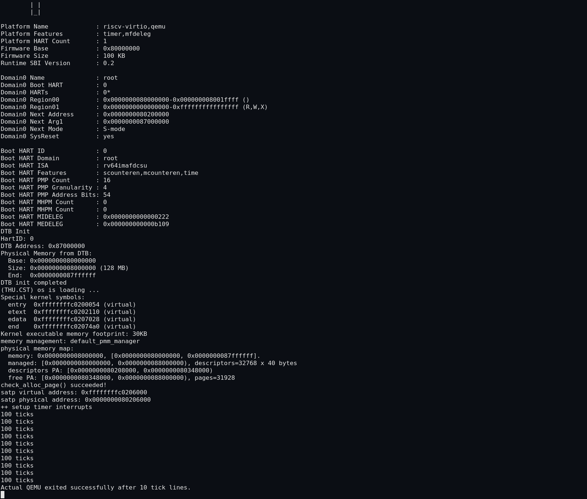
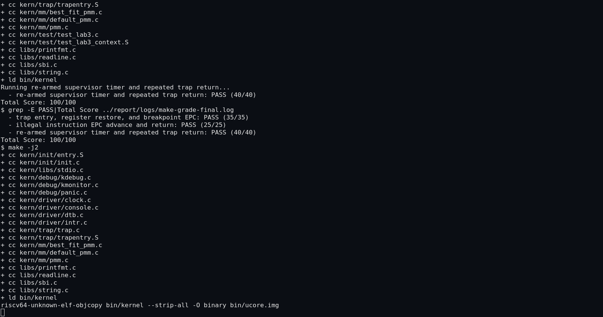
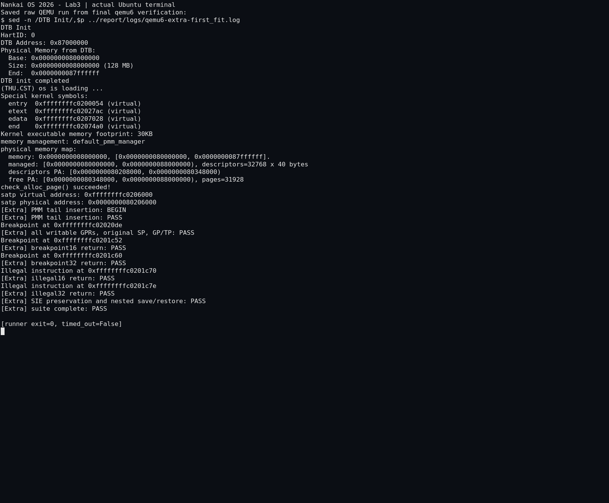
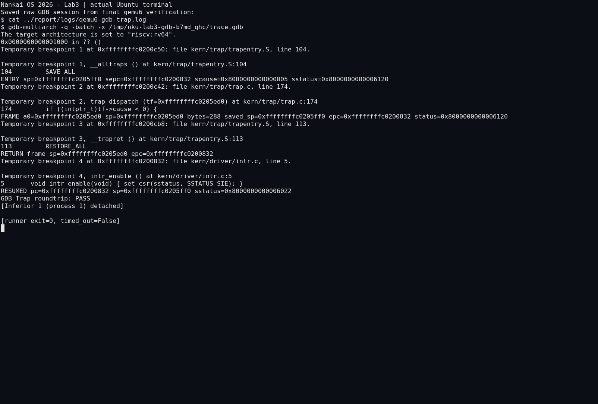
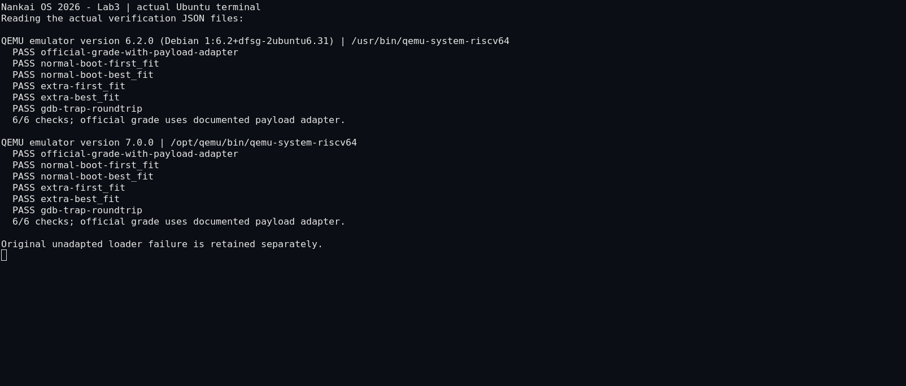

# 操作系统实验报告

## 实验基本信息

| 项目 | 内容 |
|---|---|
| 实验名称 | Lab3：中断、异常与 Trap 上下文恢复 |
| 完成日期 | 2026-10-27 |
| 小组成员 | 刘宸旭 2414139、王子卓 2411070、缪臻 2413807，沿用仓库登记 |
| 本轮实施 | 缪臻发起 Codex 全量工程实施，代码、测试与文档由本轮会话生成和执行 |
| 人工分工 | 本轮未记录其他成员的实际操作，不用 Lab2 分工推断 Lab3 贡献；小组按实际情况核对 |
| 验收状态 | 本地构建与自动验证完成；助教现场验收尚未进行 |

### 小组分工与文档维护

本次按“内存迁移与启动、Trap 汇编、C 处理程序、验证与报告”组织模块。四部分均已在当前分支落地。人工责任分配保留给小组据实际贡献填写；报告没有将未发生的人工操作记为事实。

## 一、实验目的

理解 RISC-V 中断和异常的硬件入口，完成“保存现场—进入 C 处理函数—处理事件—恢复现场—返回原执行流”的闭环。通过断点、非法指令、连续时钟和独立寄存器检查验证恢复行为，并保留可复现的构建、运行和调试证据。

范围依据 [课程练习](http://oslab.mobisys.top/lab2026/_book/lab3/lab3_2_1_exercise.html) 与 [报告要求](http://oslab.mobisys.top/lab2026/_book/lab3/lab3_4_lab_requirement.html)，要求文本已保存在 [本地快照](logs/course-requirements-20261027.txt)。

## 二、实验环境

| 项目 | 实际使用 |
|---|---|
| 宿主与命令入口 | Windows，PowerShell 7；Linux 工具通过 WSL 调用 |
| Linux | Ubuntu-22.04，精确内核及工具版本见环境日志 |
| 编译工具链 | `riscv64-unknown-elf-gcc` 10.2.0，RV64，GNU Make 4.3 |
| 主验证环境 | `/usr/bin/qemu-system-riscv64` 6.2.0，OpenSBI 0.9 |
| 兼容验证环境 | `/opt/qemu/bin/qemu-system-riscv64` 7.0.0，OpenSBI 1.0 |
| 调试 | `gdb-multiarch`，QEMU GDB stub |
| AI 工具 | Codex 桌面会话，GPT-6 系列；精确型号未独立核验，不填写猜测值 |
| 截图 | Xvfb 中真实 xterm 窗口捕获；运行命令与日志回读均有明确标签 |

见 [环境日志](logs/environment.log)、[ELF 头](logs/kernel-elf-header.log) 和 [镜像大小](logs/kernel-size.log)。原始 `lab3_new` 共 56 个文件，与原始 ZIP 核对一致后复制到独立 `lab3` Git 工作树。此前 Lab1、Lab2 和原始材料的文件指纹单独核对。

## 三、实验整体逻辑分析

### 3.1 逻辑主线

`entry.S` 设置根页表与内核栈，保存 OpenSBI 传入的 hartid/DTB。`kern_init()` 清 BSS、解析 DTB、初始化控制台与物理页管理，并将 `stvec` 指向 `__alltraps`。时钟初始化设置第一次事件、开放 `sie.STIE`，随后开放 `sstatus.SIE`。

发生 Trap 时，硬件记录 `sepc/scause/stval` 和先前特权级/中断状态；通用寄存器仍需软件保存。`SAVE_ALL` 在当前内核栈建立帧；`__alltraps` 将帧指针交给 `trap()`；`trap_dispatch()` 按原因最高位分发到中断或异常处理。处理函数修改帧中的返回位置或计数状态，然后由 `RESTORE_ALL` 和 `sret` 回到原执行流。

### 3.2 为什么按这个顺序实现

先补齐 Lab2 留空的内存初始化和 Best-Fit，保证内核具备运行基础；再保证帧布局、汇编调用和恢复一致；随后实现 C 层事件行为，最后验证跨 Trap 的实际状态。普通打印能证明控制流到达某处，不能单独证明所有寄存器恢复或关机发生，因此另有哨兵寄存器、GDB 和退出码检查。

## 四、实验内容与实现

### 4.1 前置模块：内存迁移和启动

迁移 [page_init](../code/kern/mm/pmm.c) 与 [Best-Fit](../code/kern/mm/best_fit_pmm.c)，补齐 RAM 上界和内核起点常量。Page 数组位于内核末端后，数量为 `npage-nbase`，按实际 `sizeof(Page)=40` 计算占用；初始化先保留全部物理页，再登记数组之后的完整空闲页。

保留 Lab3 的 `atomic.h` 和 `alloc_pages/free_pages/nr_free_pages` 中断保护。默认 First-Fit，构建参数可切换 Best-Fit；切换前清理目标文件。First-Fit 两个尾插分支补 `break`，避免再次插入同一节点而破坏前驱关系。两种管理器的课程自检原文保留。

启动时补齐 Sv39 根表索引 2 的恒等映射，覆盖开启分页后的低地址过渡代码；索引 511 保留高地址别名。两项均映射同一物理 1 GiB 区间，这是启动大页映射，没有实现完整细粒度内存权限管理。

规格与提示词见 [01 迁移规格](prompts/01-lab2-port.md)。实际前后失败对照见 [迭代记录](iterations.md)。

### 4.2 功能模块一：上下文恢复与 Trap 入口

涉及 [trapentry.S](../code/kern/trap/trapentry.S) 的 `RESTORE_ALL`、`__alltraps`；结构体见 [trap.h](../code/kern/trap/trap.h)。

| 帧字段 | 槽位 | RV64 字节偏移 |
|---|---|---|
| x0…x31 | 0…31 | 0…248 |
| 原 sp/x2 | 2 | 16 |
| status | 32 | 256 |
| epc | 33 | 264 |
| badvaddr / cause | 34 / 35 | 272 / 280 |

帧共 288 字节，保持 16 字节栈对齐。`SAVE_ALL` 先经 `sscratch` 暂存原 sp，再把它写入第 2 槽。恢复时先恢复 `sstatus/sepc`，随后恢复通用寄存器，最后从第 2 槽恢复 sp；不能提前改变用作帧基址的 sp。`badvaddr/cause` 是诊断信息，不作为通用状态写回。x0 由硬件固定为零。

`__alltraps` 把当前 sp 放入 a0，调用 `trap()`，返回后继续现有 `__trapret`。恢复使用 C 处理函数可能更新过的 epc。保持保存的 SPP/SPIE，由 `sret` 决定返回模式和中断状态；本实验主路径为 S→S，不无条件清 SPP 去返回 U 模式。

规格：前置是内核栈可写、已构造正确帧；后置是全部可写整数寄存器及返回状态恢复，原执行流能继续。`SAVE_ALL`、结构体和 `trap()` 签名保持不变。完整四段式约束见 [02 上下文规格](prompts/02-trap-context.md)。

### 4.3 功能模块二：中断与异常处理

涉及 [trap.c](../code/kern/trap/trap.c) 中两个处理函数和指定区域内的长度助手、统计状态。区域外的函数原文不变。

`interrupt_handler(tf)` 去掉中断标志位后分类。S 时钟分支每次重设下一事件，`ticks` 增加一次，每 100 次使用已有函数打印 `100 ticks`；第十次统计输出调用 `sbi_shutdown()`。指导书使用 `SHUTDOWN_AFTER` 名称但未给值，本实现显式选择 10，即正常运行 1000 ticks 后关机；这是本次实现参数，不声称是课程唯一数值。

其他已定义的软件、时钟和外部中断输出类型提示；未知原因号输出原因和完整帧。时钟分支不修改 epc。`ticks` 的 volatile 保证主执行流能观察中断中的更新，但它本身不构成多核同步方案。

`exception_handler(tf)` 对非法指令和断点输出规定文本及地址。从本实验可读内核地址取得第一半字：低两位不为 `11` 按 16 位处理；满足标准 32 位编码形态时按 4 字节处理，更新帧中 epc。更长编码显式终止，不误报支持。其他异常只输出帧，不任意跳过未知指令。

独立测试强制使用 `9002`、`00100073` 两种断点编码及 `0000`、`0000007b` 两种非法编码；[反汇编记录](logs/qemu6-extra-first_fit-instructions.log) 与运行后的返回标记共同验证长度处理。完整约束见 [03 处理程序规格](prompts/03-trap-handlers.md)。

### 4.4 实现迭代与兼容处理

第一版补齐两个 Trap 模块后直接编译通过。本轮真正暴露并修复的是：原始 raw loader 参数没有形成可启动 payload、First-Fit 相邻尾块合并失败，以及 QEMU 7.0 暴露启动低地址映射缺失。每项均保留失败日志和修复后验证，没有虚构寄存器遗漏等未发生的问题。

普通启动改用 `-kernel`。官方测试经 [独立适配器](../code/tools/qemu_compat/qemu-system-riscv64) 将其固定 loader 参数转换为同一镜像的 kernel payload 参数，随后直接执行真实 QEMU。它不生成任何 PASS 文本、不改退出码。原始五个官方文件 SHA-256 保持一致；原始 0/100 与适配后 100/100 分别记录。

完整过程见 [迭代记录](iterations.md)，验证规格见 [04 验证与交付](prompts/04-validation.md)。

## 五、测试与验证

### 5.1 最终结果

| 项目 | QEMU 6.2 / OpenSBI 0.9 | QEMU 7.0 / OpenSBI 1.0 |
|---|---|---|
| 官方上下文/断点组 | 35/35 | 35/35 |
| 官方非法指令/兜底组 | 25/25 | 25/25 |
| 官方持续时钟组 | 40/40 | 40/40 |
| First-Fit 普通启动与关机 | 10 行统计，正常退出 | 10 行统计，正常退出 |
| Best-Fit 普通启动与关机 | 10 行统计，正常退出 | 10 行统计，正常退出 |
| First-Fit 附加回归 | 通过 | 通过 |
| Best-Fit 附加回归 | 通过 | 通过 |
| GDB Trap 往返断言 | 通过 | 通过 |

矩阵中的“6/6”将官方三组评分合计记为一项，再加两种普通启动、两种附加回归和一项 GDB 检查。不是只有六条断言，也不表示测试穷尽所有异常。

- [QEMU 6.2 完整矩阵](logs/verification-qemu6.json)
- [QEMU 7.0 完整矩阵](logs/verification-qemu7.json)
- [官方 make grade 摘要](logs/make-grade-final.log)
- [最终构建](logs/final-default-build.log)、[普通启动](logs/final-boot.log)
- [测试原始指纹](logs/official-tests-baseline.json)、[交付审计](audit.json)

附加回归验证：非相邻和相邻尾插、全部可写 GPR 及原 sp/gp/tp、16/32 位断点和非法指令、内存接口在 SIE 开/关状态下保留原状态，以及嵌套保存/恢复。中断状态测试在时钟尚未启用的阶段执行；它验证状态保留，不构成对多核竞争的证明。

GDB 在汇编入口、C 函数入口、返回汇编和被打断 PC 设置断点，断言帧长 288、a0 指向帧、原 sp 正确、时钟返回 EPC 不变，返回后 SIE 恢复。实际地址和寄存器值见 [QEMU 6.2 GDB](logs/qemu6-gdb-trap.log)、[QEMU 7.0 GDB](logs/qemu7-gdb-trap.log)，不硬编码旧版本地址作为当前结果。

官方未知中断和未知异常检查使用构造帧直接调用处理函数；不据此声称真实外设中断已经端到端验证。当前完成的真实 Trap 为断点、非法指令和时钟。用户态异常安全恢复、完整系统调用、进程调度、多核同步不在本次实现范围。

### 5.2 测试截图

以下为真实终端窗口。构建/普通启动和官方评分重新执行命令；附加检查、GDB 和矩阵截图明确回读已保存的真实日志或 JSON。

构建、正常计时及关机：

官方评分摘要：

附加检查原始输出：

GDB 原始现场记录：

两版本最终矩阵：

## 六、实验总结与收获

### 6.1 与 OS 原理的联系和差异

| 知识点 | 本实验体现 | 边界 |
|---|---|---|
| 中断与异常 | 异步时钟和同步断点/非法指令统一进入 Trap | 并非每种外设都已接入 |
| 上下文保存 | Trap frame 保存整数寄存器及返回状态 | Trap 保存不等于进程切换；未管理浮点/向量上下文 |
| 特权级与返回 | SPP/SPIE 配合 sret 返回 | 本次主流程是内核 S→S，没有完整 U 态运行框架 |
| 时钟与抢占 | 周期事件能打断内核并返回 | 计数与关机不等于实现调度器 |
| 临界区 | 内存接口保存/关闭/恢复本 hart 中断状态 | 不能替代跨 hart 的锁与内存序设计 |
| 页表与启动 | 高地址别名和低地址过渡恒等映射 | 未实现完整缺页处理或细粒度访问权限 |
| SBI 与系统调用 | 内核通过 ecall 请求 OpenSBI 服务 | 与用户程序请求内核服务的 U→S 路径不同 |

原理中重要而本实验未实现的内容包括：进程/线程生命周期、时间片调度、完整系统调用分发、用户栈与内核栈切换、多核锁、缺页恢复和外设中断控制器驱动。

### 6.2 AI 协作开发的经验

规格必须同时给出布局、接口和禁止修改范围，尤其不能把 Lab2 文件整体覆盖到新增同步保护的 Lab3。一次通过普通自检也不代表边界正确：非相邻尾插曾通过，而相邻尾块回归才暴露前驱关系问题。跨版本结果需要实测，QEMU 6.2 的通过没有掩盖 QEMU 7.0 的启动失败。

报告保留原始失败、适配范围、当前源码指纹和未验证边界，使成绩能够被复核。后续人工答辩应能独立解释原 sp 的保存方式、SPP/SPIE 的作用、EPC 长度判断、一次性时钟重设，以及关中断保护的适用范围。
